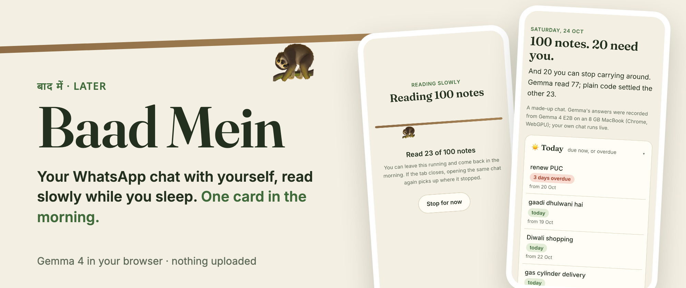

# Baad Mein (बाद में, "later")



**Live: https://baad-mein.vercel.app** · press **See an example**, or read your own chat.

Everyone has a WhatsApp chat with themselves. Links, "dahi bread aur maggi", "Raju ko 500 dena", an OTP from March. Things you'll deal with later.

Baad Mein reads that chat slowly, with Gemma 4 running inside your browser tab, and gives you one card in the morning:

- **Today and this week**: what's due, with dates worked out by code, not guessed by the model
- **Money**: who owes you, who you owe, with amounts
- **To buy**: every shopping note from the last three weeks, merged into one list
- **Not sure**: notes it won't guess about, with the reason
- **Delete these from the chat**: OTPs, card numbers, Aadhaar, PAN and passwords, masked
- **Let go**: old links, dead to-dos and stale lists you can stop carrying around

Nothing is uploaded. No account, no server, no API key.

## How it works

```
your chat export (.txt / .zip)
   │
   ├─ code ──── secrets (Luhn, Verhoeff, PAN pattern) → "delete these", never shown to Gemma
   │            bare links, empty notes → settled without Gemma
   │
   ├─ Gemma 4 E2B (MediaPipe, WebGPU, in the tab), 8 notes at a time
   │            says what kind each note is, COPIES the words that matter
   │
   └─ code ──── checks every copied word is in the note
                works out every date ("kal", "parso", "monday ko", "12 tarikh")
                reads amounts and who-owes-whom from the words
                closes a to-do when a later note says it's done
                marks anything that doesn't add up as "not sure"
```

Every batch Gemma answers is saved in IndexedDB as it arrives. Close the tab halfway, open the same chat again, and it picks up where it stopped.

## Numbers

Two made-up chats with every note labelled by hand (`src/core/data.ts`). The prompt was tuned on the 40-note dev set only and frozen (commit `28031cc`) before the 100-note held-out set was run once. Gemma 4 E2B, in Chrome on an 8 GB MacBook.

| Held-out, 100 notes | |
|---|---|
| Kind of note right | 95 / 100 |
| Due dates right | 16 / 19 (2 marked "not sure", 1 wrong) |
| Money direction right | 9 / 9 |
| Secrets caught before Gemma | 7 / 7 |
| Quotes Gemma rewrote instead of copying | 0 / 49 |
| Time | 49 s, about 5 s per 8 notes |

**Gemma doing the dates itself** (same 19 notes, the date each note was written in the prompt): **8 / 19**, and 8 of its answers weren't valid dates. That's why code does the dates.

Raw runs, with every reply, are in `eval/results/`. After the held-out run I fixed one bug it exposed (when Gemma copied the wrong words as the date, code now reads the note's own day words); the numbers above are from before that fix.

## Run it

```bash
npm install
npm run dev          # http://localhost:5173
npm test             # the code-only layer: secrets, dates, money, parsing
npm run eval         # opens eval.html: Gemma in your browser, scored against the labels
```

Needs a browser with WebGPU (Chrome or Edge on a laptop). Gemma 4 E2B (about 2 GB) downloads once and is cached.

## Credits

- [Gemma 4 E2B](https://huggingface.co/litert-community/gemma-4-E2B-it-litert-lm) (web build) via [MediaPipe LLM Inference](https://ai.google.dev/edge/mediapipe/solutions/genai/llm_inference/web_js). Gemma is subject to the [Gemma Terms of Use](https://ai.google.dev/gemma/terms).
- The WhatsApp export parser and the "kal"/"parso" date resolver are adapted from [Pakka](https://github.com/codeswithroh/pakka) (MIT).

MIT licensed.
